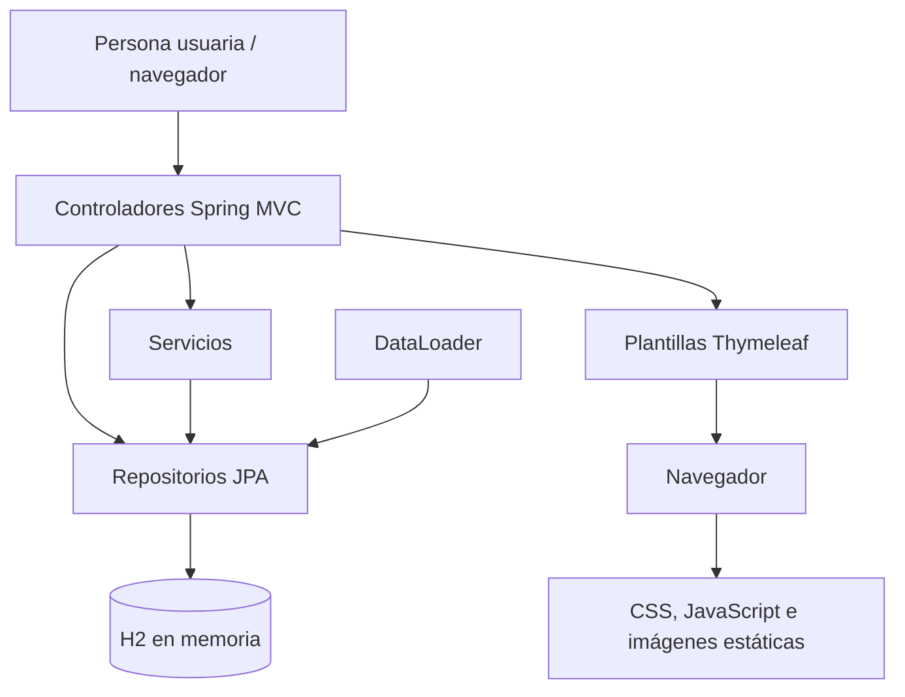
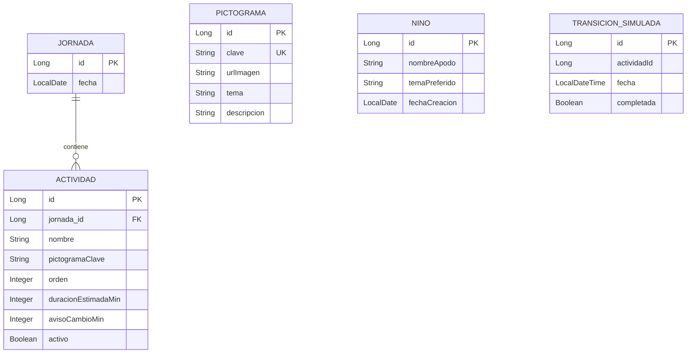

# Manual técnico — Asistente de Anticipación Visual

**Versión del manual:** 1.0  
**Fecha:** 17 de octubre de 2026  
**Última revisión:** 17 de octubre de 2026

## Índice

1. [Propósito y alcance](#1-propósito-y-alcance)
2. [Tecnologías](#2-tecnologías)
3. [Arquitectura](#3-arquitectura)
4. [Estructura del proyecto](#4-estructura-del-proyecto)
5. [Modelo de datos y carga inicial](#5-modelo-de-datos-y-carga-inicial)
6. [Rutas HTTP](#6-rutas-http)
7. [Lógica de negocio](#7-lógica-de-negocio)
8. [Interfaz y recursos estáticos](#8-interfaz-y-recursos-estáticos)
9. [Accesibilidad](#9-accesibilidad)
10. [Privacidad y seguridad](#10-privacidad-y-seguridad)
11. [Configuración](#11-configuración)
12. [Compilar, ejecutar y probar](#12-compilar-ejecutar-y-probar)
13. [Pruebas existentes](#13-pruebas-existentes)
14. [Limitaciones y próximos pasos](#14-limitaciones-y-próximos-pasos)
15. [Glosario](#15-glosario)

## 1. Propósito y alcance

Es un **prototipo web** de apoyo a la anticipación visual de una rutina diaria mediante pictogramas. La interfaz separa una vista infantil de una vista docente y convierte las actividades activas de una jornada en una secuencia ordenada.

No es un producto clínico, un sistema de expedientes, un sistema de autenticación ni una aplicación de comunicación con familias. No usa IA generativa. Las decisiones de secuencia son reglas deterministas basadas en la jornada y el orden de las actividades.

## 2. Tecnologías

| Área | Tecnología / versión | Evidencia |
|---|---|---|
| Lenguaje | Java 17 | `pom.xml` (`java.version`) |
| Framework | Spring Boot 3.3.5 | `spring-boot-starter-parent` |
| Compilación | Maven; Maven Wrapper 3.10.0 | `pom.xml`, `.mvn/wrapper/maven-wrapper.properties` |
| Web MVC | `spring-boot-starter-web` | `pom.xml` |
| Vistas | Thymeleaf (`spring-boot-starter-thymeleaf`) | `pom.xml` |
| Persistencia | Spring Data JPA | `spring-boot-starter-data-jpa` |
| Base de datos | H2 embebida, en memoria | `spring.datasource.url` |
| Validación | Spring Validation | `spring-boot-starter-validation` |
| Desarrollo | Spring Boot DevTools, opcional en tiempo de ejecución | `pom.xml` |
| Reducción de código | Lombok, opcional | `pom.xml`; las entidades actuales usan getters/setters explícitos |
| Pruebas | Spring Boot Test / JUnit Jupiter | `spring-boot-starter-test` y prueba existente |

Las versiones individuales de dependencias gestionadas no se declaran en el proyecto; las administra el BOM de Spring Boot 3.3.5. **No verificado:** versión concreta resuelta de cada dependencia en el entorno de ejecución.

## 3. Arquitectura

La aplicación sigue una estructura MVC con acceso a datos mediante repositorios JPA. No existe una capa de seguridad ni una API REST separada.



Flujo de una secuencia: `HorarioController` recibe la fecha, `SecuenciaService` localiza la jornada, consulta actividades activas ordenadas, resuelve la imagen mediante la clave del pictograma y construye DTO para `horario.html`.

## 4. Estructura del proyecto

```text
.
├── pom.xml                              # Dependencias y plugins Maven
├── mvnw / .mvn/                         # Maven Wrapper
├── PROTOTYPE.md                         # Alcance histórico del prototipo
├── PROTOTYPE-v2.md                      # Requerimientos históricos v2
├── REQUISITOS_PROTOTIPO.md              # Requisitos de referencia
├── src/main/java/com/casosofia/asistente/
│   ├── AsistenteAnticipacionVisualApplication.java # Punto de arranque
│   ├── config/DataLoader.java            # Datos demostrativos al iniciar
│   ├── controller/                       # Rutas MVC y errores
│   ├── service/                          # Secuencia y transiciones simuladas
│   ├── repository/                       # Interfaces Spring Data JPA
│   ├── model/                            # Entidades JPA
│   └── dto/                              # DTO de actividad y secuencia
├── src/main/resources/
│   ├── application.properties            # Configuración de ejecución
│   ├── messages.properties               # Mensajes en español; no se observó uso en vistas
│   ├── templates/                        # Vistas Thymeleaf y fragmentos comunes
│   └── static/                           # CSS, JS, cursor e imágenes PNG
└── src/test/java/...ApplicationTests.java # Prueba de carga de contexto
```

Clases principales:

| Paquete | Elementos | Responsabilidad real |
|---|---|---|
| `controller` | `HorarioController`, `ActividadController`, `CambioRutinaController`, `GlobalExceptionHandler` | Rutas, preparación del modelo y redirecciones |
| `service` | `SecuenciaService`, `CambioRutinaService` | Construcción de DTO y registro simulado de transiciones |
| `repository` | Repositorios de las cinco entidades | Consultas derivadas y CRUD JPA |
| `model` | `Jornada`, `Actividad`, `Pictograma`, `Nino`, `TransicionSimulada` | Persistencia |
| `dto` | `ActividadDTO`, `SecuenciaDTO` | Datos que consume la vista de secuencia |
| `config` | `DataLoader` | Catálogo y jornada demostrativos |

## 5. Modelo de datos y carga inicial



`Actividad.pictogramaClave` se resuelve por código contra `Pictograma.clave`; no hay una relación JPA entre ambas. `TransicionSimulada.actividadId` es un valor escalar, no una clave foránea declarada. `Nino` y su repositorio existen, pero no hay controlador, vista ni carga inicial que los utilice.

`DataLoader` crea, cuando las tablas respectivas están vacías:

- Seis pictogramas: `comida`, `banio`, `recreo`, `clase`, `traslado` y `siesta`.
- Una jornada con la fecha actual del servidor.
- Seis actividades demostrativas activas, ordenadas del 1 al 6.

El origen de estas demostraciones es código Java; no hay archivos SQL, migraciones ni scripts de semilla separados.

## 6. Rutas HTTP

| Método | Ruta | Controlador | Vista / respuesta | Descripción |
|---|---|---|---|---|
| GET | `/` | `HorarioController.inicio` | Redirección a `/horario/{fecha-hoy}` | Inicio |
| GET | `/horario/{fecha}` | `HorarioController.verSecuencia` | `horario` | Secuencia de actividades activas para la fecha |
| GET | `/actividad/{id}` | `HorarioController.verActividad` | `actividad` | Actividad individual y tiempo estimado |
| GET | `/aviso-cambio` | `HorarioController.avisoCambio` | `aviso-cambio` | Aviso con valor fijo de 5 minutos |
| GET | `/docente/horario` | `ActividadController.listarHorario` | `docente/horario` | Jornada de la fecha actual |
| GET | `/docente/horario/{fecha}` | `ActividadController.listarHorarioFecha` | `docente/horario` | Jornada de una fecha indicada |
| GET | `/docente/actividad-form` | `ActividadController.formularioActividad` | `docente/actividad-form` | Formulario nuevo o edición mediante `jornadaId`/`actividadId` opcionales |
| POST | `/docente/actividad` | `ActividadController.guardarActividad` | Redirección o formulario | Guarda una actividad válida ligada a una jornada existente |
| GET | `/docente/previa/{fecha}` | `ActividadController.previaSofia` | `docente/previa-sofia` | Lista previa de actividades activas |
| POST | `/cambio-rutina` | `CambioRutinaController.anunciarCambio` | Redirección a `/aviso-cambio` | Crea una transición simulada no completada |
| POST | `/transicion` | `CambioRutinaController.registrarTransicion` | Redirección al horario de hoy | Crea una transición simulada completada |
| Cualquier método | `/error` | `GlobalExceptionHandler.error` | `error` | Vista de error genérica |

Los manejadores de `IllegalArgumentException`, `NoHandlerFoundException` y `Exception` también devuelven la vista `error`.

## 7. Lógica de negocio

### Construcción de la secuencia

1. Se recibe una fecha en `/horario/{fecha}`.
2. `SecuenciaService` busca una `Jornada` por fecha.
3. Si no existe, lanza `IllegalArgumentException`; el manejador global presenta `error.html`.
4. Consulta actividades de esa jornada con `activo = true`, ordenadas ascendentemente por `orden`.
5. Para cada actividad, busca un `Pictograma` por su `pictogramaClave`.
6. Construye `ActividadDTO` con datos de la actividad y la URL del pictograma.
7. Si no encuentra el pictograma, usa `/img/pictogramas/placeholder.png` como respaldo. Ese archivo no está en los recursos actuales; esta ruta de respaldo es una limitación.

### Actividades y transiciones

- Al guardar, se comprueba que la jornada exista. Si `orden` es nulo, se asigna `número de actividades existentes + 1`.
- El formulario expone el orden como número; no hay una función de reordenamiento interactivo.
- Los POST de cambio y transición crean registros `TransicionSimulada`. El parámetro `minutos` de `/cambio-rutina` se recibe, pero el servicio no lo persiste ni lo utiliza.

## 8. Interfaz y recursos estáticos

### Plantillas

| Archivo | Uso |
|---|---|
| `fragments.html` | Cabecera, pie, carga de CSS/JS y menú de accesibilidad docente |
| `horario.html` | Secuencia infantil por fecha |
| `actividad.html` | Actividad actual; muestra duración estimada |
| `aviso-cambio.html` | Aviso visual; solo muestra pictograma si el modelo aporta `actividadSiguiente` |
| `docente/horario.html` | Tabla de actividades y accesos a edición/previa |
| `docente/actividad-form.html` | Alta y edición |
| `docente/previa-sofia.html` | Previa de secuencia |
| `error.html` | Error genérico |

### CSS

`static/css/styles.css` contiene tokens de color, componentes y diseño adaptable. Tokens principales: `--fondo`, `--fondo-secundario`, `--fondo-componente`, `--borde`, `--boton`, `--boton-hover`, `--boton-exito`, `--texto`, `--texto-soporte` y `--blanco`.

| Consulta de medios | Uso |
|---|---|
| `max-width: 640px` | Móvil: columna única, tabla docente en tarjetas y panel ajustado |
| `641px–1024px` | Tableta |
| `1025px–1366px` | Laptop |
| `min-width: 1367px` | Escritorio |
| `min-width: 1920px` | Proyección/TV; tipografía y pictogramas ampliados |

### JavaScript

`static/js/app.js` implementa:

- Aviso visual temporal al pulsar el botón de cambio de rutina de la secuencia.
- Botón flotante “Ir arriba”. Usa salto inmediato si se desactivan las animaciones o si el sistema indica `prefers-reduced-motion`.
- Menú de accesibilidad en la vista docente: apertura, cierre exterior, tecla Escape y botón “Aceptar”.
- Preferencias de tamaño de texto, contraste, fuente, cursor, enlaces, guía visual y animaciones.
- Destino de las preferencias: docente, ambas vistas o solo vista infantil.

Las preferencias se guardan localmente en el navegador mediante `localStorage`: `destinoAccesibilidad`, `tamanoTexto`, `contraste`, `fuente`, `cursor`, `enlaces`, `guiaLectura` y `animaciones`. Existe además lectura de la clave heredada `aplicarAccesibilidadSofia`.

### Recursos gráficos

Hay imágenes PNG de pictogramas en `static/img/pictogramas/`: `banio`, `clase`, `comida`, `recreo`, `siesta` y `traslado`. También hay dos archivos para cursor ampliado. No se observó un catálogo remoto ni carga de archivos desde la interfaz.

## 9. Accesibilidad

Implementaciones observadas:

- Idioma español en las plantillas y encabezados/pies semánticos.
- Títulos, secciones, tablas y formularios con elementos HTML nativos.
- Texto alternativo dinámico en los pictogramas de secuencia, actividad y tabla docente.
- Indicador `:focus-visible`, `scroll-padding-top` y botones de tamaño aumentado en la vista infantil.
- Diseño adaptable sin desbordamiento horizontal verificado previamente en las vistas de secuencia y horario docente entre 320 y 3840 px.
- Menú de accesibilidad operable con ratón y teclado: Escape, clic exterior, foco devuelto al activador y botón “Aceptar”.
- Escalado de texto en el elemento raíz; tamaños normal, grande y muy grande.
- Opción para detener animaciones; el botón “Ir arriba” también respeta `prefers-reduced-motion`.
- Panel móvil con controles de al menos 48 px en las opciones de accesibilidad.

**Estado de conformidad:** no existe una auditoría formal WCAG 2.2 AA, por lo que la conformidad completa es **No verificado**.

Brechas conocidas:

- El pictograma de `docente/previa-sofia.html` no tiene atributo `alt`.
- No se encontró una región `aria-live` para el aviso temporal creado por JavaScript.
- No hay evidencia de pruebas con lector de pantalla, contraste automatizado, navegación completa por teclado ni zoom al 200 %; **No verificado**.
- La preferencia del sistema de movimiento reducido solo se consulta explícitamente para “Ir arriba”; no se observó una regla CSS global `prefers-reduced-motion`.

## 10. Privacidad y seguridad

La configuración usa H2 en memoria y `create-drop`: los datos persistidos por JPA desaparecen al detener la aplicación. Se almacenan jornadas, actividades, pictogramas y transiciones simuladas. La entidad `Nino` permite apodo y tema preferido, pero no se usa desde una ruta, vista ni carga inicial.

Las preferencias de accesibilidad se guardan en el navegador local. No se observó envío de información a servicios externos desde el código revisado.

No hay configuración de Spring Security, autenticación, roles, autorización, cifrado de base de datos, auditoría ni protección de acceso docente. El acceso está abierto en el prototipo. No hay secretos, tokens ni contraseñas configurados en los archivos revisados.

## 11. Configuración

Archivo: `src/main/resources/application.properties`.

| Propiedad | Función |
|---|---|
| `spring.application.name` | Nombre de la aplicación |
| `spring.datasource.url` | Conexión a H2 en memoria |
| `spring.datasource.driver-class-name` | Controlador de H2 |
| `spring.h2.console.enabled` | Consola H2; está desactivada |
| `spring.jpa.hibernate.ddl-auto` | Creación/eliminación del esquema al iniciar/detener |
| `spring.jpa.show-sql` | Trazas SQL; desactivadas |
| `spring.jpa.defer-datasource-initialization` | Orden de inicialización de datos |
| `spring.thymeleaf.prefix`, `suffix`, `mode`, `encoding`, `cache` | Renderizado Thymeleaf |
| `server.port`, `server.servlet.context-path` | Puerto y contexto web |

No se encontraron perfiles, variables de entorno declaradas, archivos YAML ni propiedades de secretos. **No verificado:** valores proporcionados desde fuera del repositorio al arrancar.

## 12. Compilar, ejecutar y probar

Requisitos: JDK 17 y acceso a Maven Central en la primera resolución de dependencias. En macOS/Linux:

```bash
./mvnw clean package
./mvnw spring-boot:run
```

En Windows:

```bat
mvnw.cmd clean package
mvnw.cmd spring-boot:run
```

La aplicación queda configurada para el puerto `8080`. Ejemplo de consulta: `http://localhost:8080/horario/2026-10-17`.

Para pruebas:

```bash
./mvnw test
```

La consola H2 no está disponible porque `spring.h2.console.enabled=false`. El entorno de documentación no pudo ejecutar Maven por restricciones de conectividad hacia el repositorio de dependencias; la aplicación local ya en ejecución sí fue consultada mediante navegador.

## 13. Pruebas existentes

Solo existe `AsistenteAnticipacionVisualApplicationTests.contextLoads`, anotada con `@SpringBootTest`. Comprueba que el contexto de Spring arranque.

No se encontraron pruebas de controladores, servicios, repositorios, validación, accesibilidad, interfaz, persistencia o cobertura. No se encontró herramienta de medición de cobertura.

## 14. Limitaciones y próximos pasos

| Prioridad | Limitación actual | Siguiente paso sugerido |
|---|---|---|
| Alta | Acceso docente sin autenticación ni autorización | Definir modelo de acceso y protección de datos antes de uso fuera de demostración |
| Alta | Base H2 en memoria con `create-drop` | Definir persistencia y política de retención para un entorno posterior al prototipo |
| Alta | No hay auditoría WCAG completa; falta `alt` en una vista | Corregir el texto alternativo y realizar pruebas con teclado, lector de pantalla, contraste y zoom |
| Alta | La ruta de respaldo `placeholder.png` no existe | Añadir recurso o gestionar explícitamente la ausencia de pictograma |
| Media | El aviso de cambio no recibe actividad siguiente desde el controlador | Definir y conectar la regla de aviso si se mantiene esta pantalla |
| Media | `minutos` de cambio no se usa; transiciones son simuladas | Modelar el evento y su duración solo si el alcance lo requiere |
| Media | Reordenamiento no está implementado como función de interfaz | Definir un flujo accesible de ordenación |
| Media | `Nino` no participa en la interfaz ni en la carga de datos | Decidir si se elimina o se incorpora con minimización de datos |
| Baja | Documentos históricos contienen afirmaciones que no coinciden con el código actual | Mantener los manuales como referencia operativa y revisar documentos de requisitos |

## 15. Glosario

| Término | Significado en este proyecto |
|---|---|
| Jornada | Registro de un día con sus actividades |
| Actividad | Elemento ordenado de una jornada, con duración y pictograma |
| Pictograma | Recurso PNG identificado por una clave |
| Secuencia | Lista de actividades activas ordenadas para una fecha |
| DTO | Objeto preparado para transportar datos hacia una vista |
| Thymeleaf | Motor que renderiza HTML en el servidor |
| H2 en memoria | Base de datos temporal que se pierde al detener la aplicación |
| Transición simulada | Registro de prueba de cambio o finalización de una actividad |
